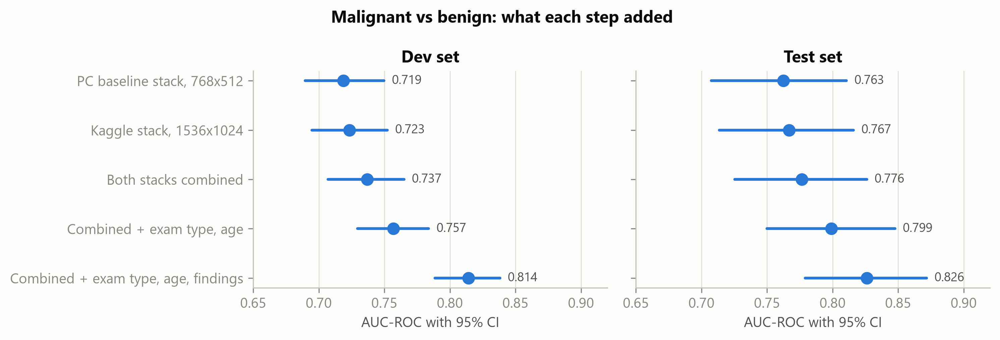
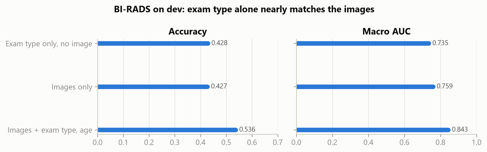
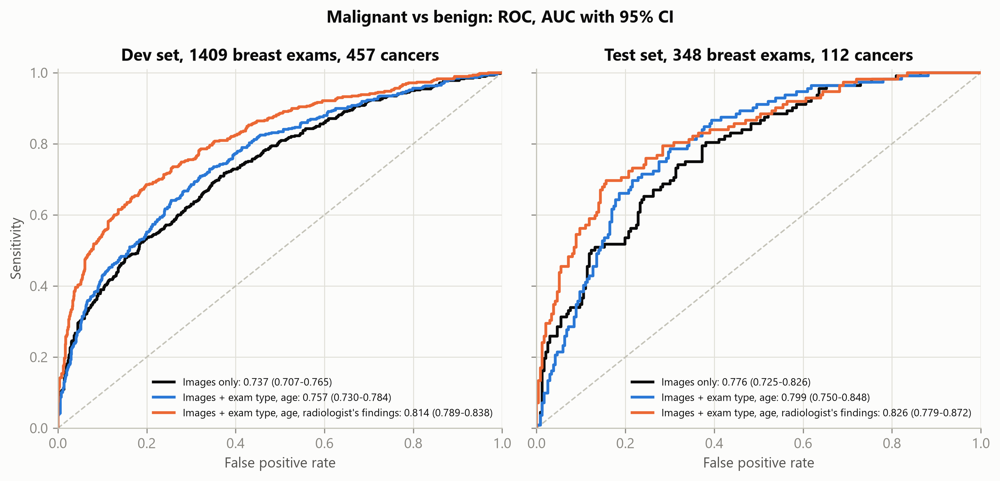
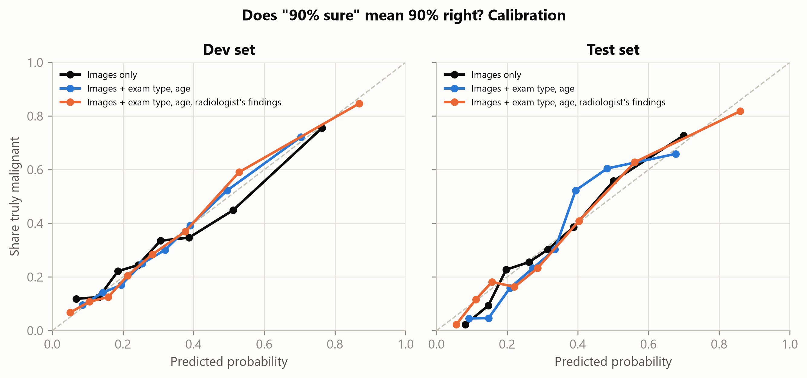
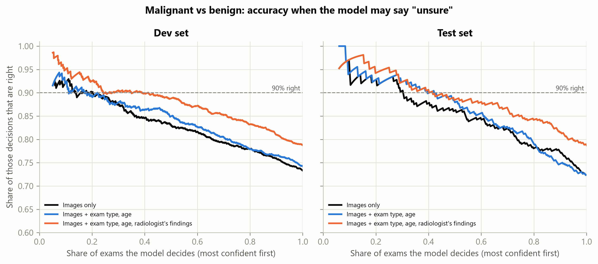
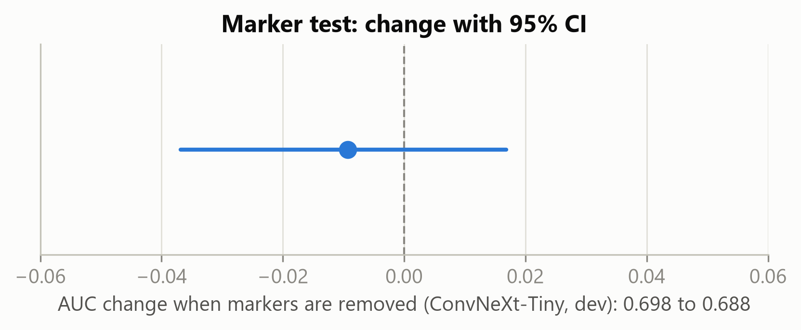

# Breast Cancer Classification on EMBED

**A deep-learning study on the Emory Breast Imaging Dataset.** Malignant vs. benign classification on biopsy-confirmed mammograms, plus BI-RADS assessment, with a pre-registered test plan, patient-level validation and an audit for shortcut learning.

📄 **[Read the full report (PDF, 20 pages)](report/EMBED_breast_cancer_report.pdf)**

> [!NOTE]
> **Publication approved by the data source.** Public release of this report, its results and its figures, including the de-identified EMBED mammograms and Grad-CAM maps, was approved in writing on 2 November 2026 by Dr. Hari Trivedi, Co-director of the HITI Lab at Emory University, which maintains the EMBED dataset.

Team project at Southwest Petroleum University, School of Computer Science, supervised by Prof. Li Ping (Department of Artificial Intelligence). Team lead: Imad Lembachar, with Meriem Boudira, Mohammed Ismail Touati and Ghizlane Ben Mhamed. September–November 2026.

---

## Results

**Malignant vs. benign**: locked test set of 348 breast exams (112 cancers). Six-model ensemble; thresholds chosen on dev.

| Inputs | Test AUC (95% CI) | Accuracy | Sensitivity | Specificity | Dev AUC |
|---|---|---|---|---|---|
| Images only | 0.776 (0.725–0.826) | 73.3% | 26% | 96% | 0.737 |
| + exam type, age | 0.799 (0.750–0.848) | 73.6% | 40% | 89% | 0.757 |
| + radiologist's pre-biopsy findings | **0.826 (0.779–0.872)** | 78.7% | 57% | 89% | 0.814 |

<p align="center">
  
</p>

**BI-RADS** (11,268 exams, 2,254 in test): images alone reach a macro AUC of 0.781, but **exam type alone nearly matches the image model on dev** (42.8% vs 42.7% accuracy). The images reveal the exam type through acquisition markers, so image-only BI-RADS scores overstate reading skill.

<p align="center">
  
</p>

| | |
|---|---|
|  |  |
|  |  |

## Method

- **Data**: EMBED (Emory), open S3 bucket. Task A uses exams 1–180 days before a biopsy: 3,407 images, 1,757 breast exams, 1,513 patients. Malignant if any pathology severity is 0–1; severities 2, 3 and 5 are excluded; otherwise benign.
- **Splits**: patient-level. 5 dev folds plus a locked test set, opened once after the [test plan](results/proof/test_plan_malignant.md) was written.
- **Models**: ResNet-50, EfficientNetV2-S and ConvNeXt-Tiny (ImageNet-pretrained), stacked with logistic regression on out-of-fold predictions. Trained on a local GPU (768×512) and on Kaggle GPUs (1536×1024).
- **Evaluation**: breast-exam level, with patient-level bootstrap 95% CIs, subgroup analysis by manufacturer and exam kind, calibration, and confidence-coverage curves.
- **Shortcut checks**: Grad-CAM, plus a marker-inpainting test (ConvNeXt dev AUC 0.698 → 0.688, Δ −0.009, CI −0.037 to 0.017).
- **Reproducibility**: SHA-256 [manifest](results/proof/manifest.csv) of 336 artifacts, the Kaggle environment and a full pip freeze in [`results/proof/`](results/proof). Every number is in [`final_summary.csv`](results/metrics/final_summary.csv).

## Limitations

- All results are well below a clinical bar. **This is not a medical device and not fit for clinical use.**
- Every Task A exam led to a biopsy, so benign cases already looked suspicious. This is harder than cancer vs. normal, and the results do not transfer to screening.
- Single institution, no external validation. Confidence intervals are wide.
- Test scores run above dev, partly because each test exam gets the average of five fold models.

## Repository layout

```
src/        pipeline: s0_weights → s1_build_metadata → s2_fetch_images → s3_train → s4_evaluate → s5/s6 figures → s7_proof
kaggle/     job builder, runner and result import for Kaggle GPU runs
configs/    run settings (resolution, folds, models)
results/    aggregate metrics, final figures, proof files
docs/       fix log: every bug found and how it was fixed
report/     full written report
```

Run order: `python src/run_pipeline.py` (add `--dry-run` for a small smoke test, `--final` to open the locked test set). Set `EMBED_CONFIG=kaggle_v2.json` to use the Kaggle settings. You need your own EMBED access and AWS credentials in a `.env` file one level above the repo (`aws_access_key_id`, `aws_secret_access_key`).

## Data and privacy

Results, charts and the full report (with its de-identified mammogram figures) are published with written approval from Dr. Hari Trivedi of the Emory HITI Lab, the team behind EMBED, given on 2 November 2026. The repository does not redistribute the dataset itself: no raw images, per-patient tables, predictions or model weights are included. To reproduce the work, request your own access to EMBED from Emory.

## Citation

> Jeong, J. J., et al. *The EMory BrEast imaging Dataset (EMBED): A Racially Diverse, Granular Dataset of 3.4 Million Screening and Diagnostic Mammographic Images.* Radiology: Artificial Intelligence, 2023.
