# Breast Cancer Classification on EMBED

**A deep-learning study on the Emory Breast Imaging Dataset.** Malignant vs. benign classification on biopsy-confirmed mammograms, plus BI-RADS assessment, with a pre-registered test plan, patient-level validation and an audit for shortcut learning.

<p>
  <a href="report/EMBED_breast_cancer_report.pdf"></a>
  
  
  
</p>

> [!NOTE]
> **Publication approved by the data source.** Public release of this report, its results and its figures, including the de-identified EMBED mammograms and Grad-CAM maps, was approved in writing on 2 November 2026 by Dr. Hari Trivedi, Co-director of the HITI Lab at Emory University, which maintains the EMBED dataset.

Team project at Southwest Petroleum University, School of Computer Science, supervised by Prof. Li Ping (Department of Artificial Intelligence). Team lead: Imad Lembachar, with Meriem Boudira, Mohammed Ismail Touati and Ghizlane Ben Mhamed. September–November 2026. This study is phase 2 of the team's medical-imaging work, which began as [NeuroSentry](#background-neurosentry-phase-1) on head CT.

<p align="center">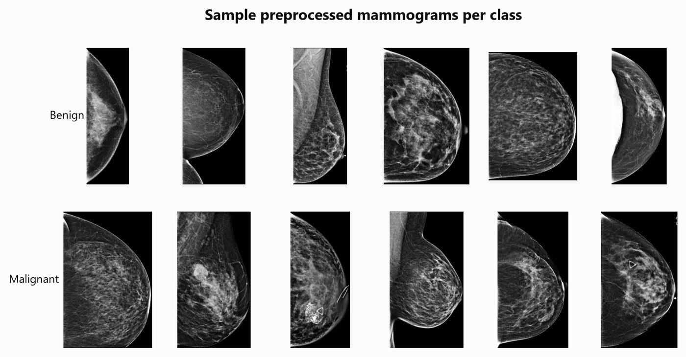</p>
<p align="center"><sub><b>Figure 3.</b> Example EMBED images from Task A after crop and resize.</sub></p>

---

## Results

**Malignant vs. benign**: locked test set of 348 breast exams (112 cancers). Six-model ensemble; thresholds chosen on dev.

| Inputs | Test AUC (95% CI) | Accuracy | Sensitivity | Specificity | Dev AUC |
|---|---|---|---|---|---|
| Images only | 0.776 (0.725–0.826) | 73.3% | 26% | 96% | 0.737 |
| + exam type, age | 0.799 (0.750–0.848) | 73.6% | 40% | 89% | 0.757 |
| + radiologist's pre-biopsy findings | **0.826 (0.779–0.872)** | 78.7% | 57% | 89% | 0.814 |

<p align="center">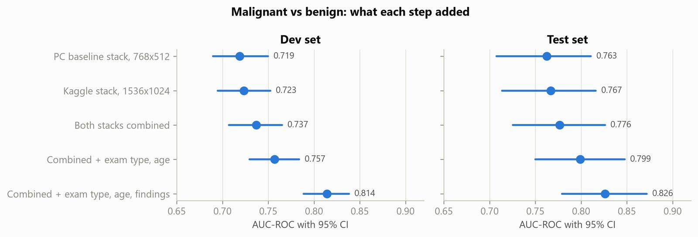</p>
<p align="center"><sub><b>Figure 1.</b> AUC on Task A at each step, on dev and test: 768×512 stack, 1,536×1,024 stack, both combined, then exam type and age, then the radiologist's findings. Lines show the 95% bootstrap CI.</sub></p>

### What the model looks at

<p align="center">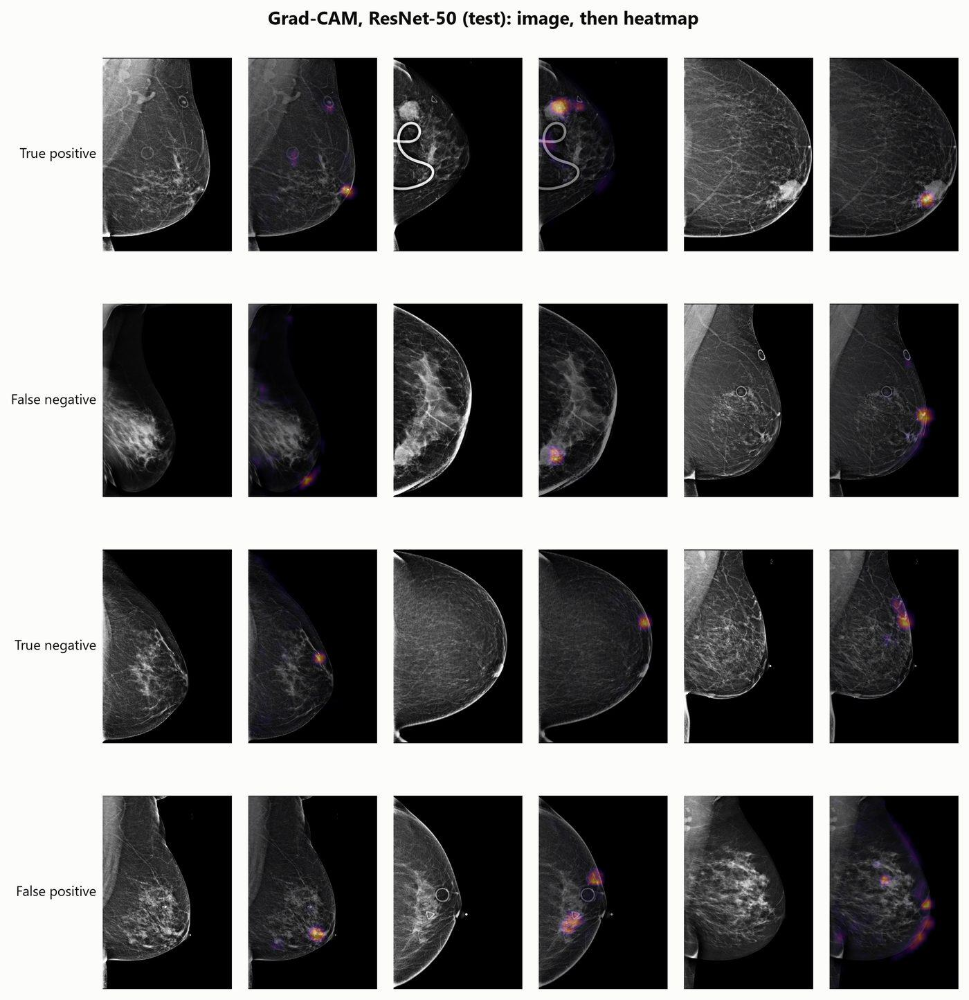</p>
<p align="center"><sub><b>Figure 16.</b> Grad-CAM maps on Task A test exams (ResNet-50). Attention is mostly on tissue, with some weight on image markers.</sub></p>

### A shortcut, found and reported

**BI-RADS** (11,268 exams, 2,254 in test): images alone reach a macro AUC of 0.781, but **exam type alone nearly matches the image model on dev** (42.8% vs 42.7% accuracy). The images reveal the exam type through acquisition markers, so image-only BI-RADS scores overstate reading skill.

<p align="center"></p>
<p align="center"><sub><b>Figure 20.</b> BI-RADS on dev: exam type alone nearly matches the image stack, so the image-only model may be learning the exam-type cue rather than lesion content.</sub></p>

## Method

- **Data**: EMBED (Emory), open S3 bucket. Task A uses exams 1–180 days before a biopsy: 3,407 images, 1,757 breast exams, 1,513 patients. Malignant if any pathology severity is 0–1; severities 2, 3 and 5 are excluded; otherwise benign.
- **Splits**: patient-level. 5 dev folds plus a locked test set, opened once after the [test plan](results/proof/test_plan_malignant.md) was written.
- **Models**: ResNet-50, EfficientNetV2-S and ConvNeXt-Tiny (ImageNet-pretrained), stacked with logistic regression on out-of-fold predictions. Trained on a local GPU (768×512) and on Kaggle GPUs (1536×1024).
- **Evaluation**: breast-exam level, with patient-level bootstrap 95% CIs, subgroup analysis, calibration, and confidence-coverage curves.
- **Shortcut checks**: Grad-CAM, plus a marker-inpainting test (ConvNeXt dev AUC 0.698 → 0.688, Δ −0.009, CI −0.037 to 0.017).
- **Reproducibility**: SHA-256 [manifest](results/proof/manifest.csv) of 336 artifacts, the Kaggle environment and a full pip freeze in [`results/proof/`](results/proof). Every number is in [`final_summary.csv`](results/metrics/final_summary.csv).

## Limitations

- All results are well below a clinical bar. **This is not a medical device and not fit for clinical use.**
- Every Task A exam led to a biopsy, so benign cases already looked suspicious. This is harder than cancer vs. normal, and the results do not transfer to screening.
- Single institution, no external validation. Confidence intervals are wide.
- Test scores run above dev, partly because each test exam gets the average of five fold models.

## All figures from the report

Every figure from the [report](report/EMBED_breast_cancer_report.pdf), with its caption. Click a section to expand it.

<details>
<summary><b>Data and preprocessing</b> · Figures 2, 3, 4, 5, 6</summary>
<br>

<p align="center">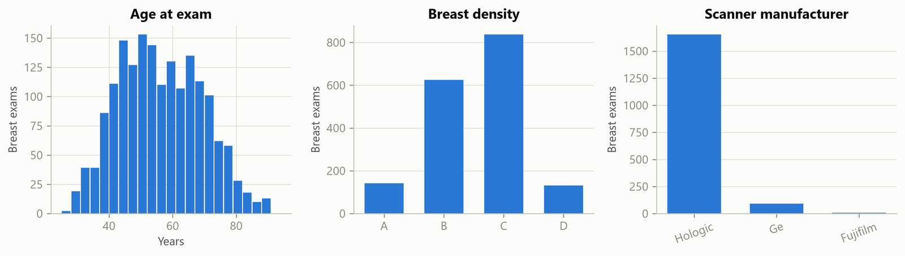</p>
<p align="center"><sub><b>Figure 2.</b> Task A cohort: age at exam, breast density and scanner manufacturer.</sub></p>

<p align="center"></p>
<p align="center"><sub><b>Figure 3.</b> Example EMBED images from Task A after crop and resize.</sub></p>

<p align="center">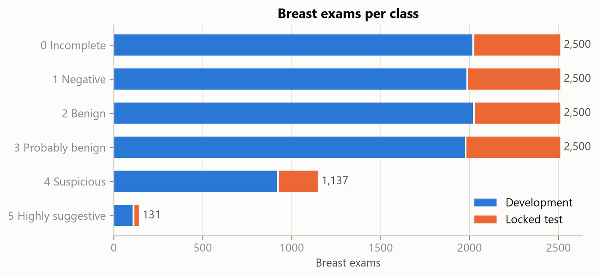</p>
<p align="center"><sub><b>Figure 4.</b> Task B cohort: breast exams per BI-RADS class in dev and the locked test set, after the cap.</sub></p>

<p align="center">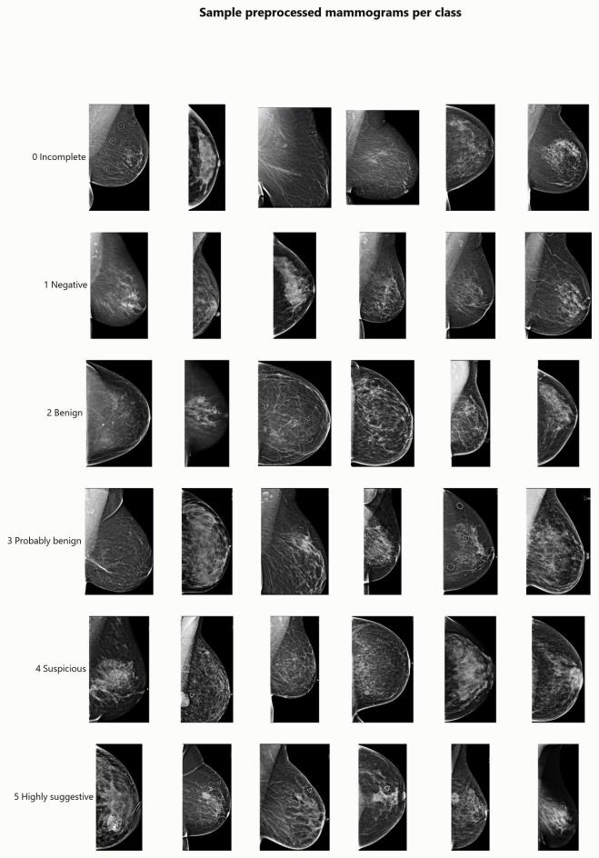</p>
<p align="center"><sub><b>Figure 5.</b> Example EMBED images for Task B across BI-RADS categories.</sub></p>

<p align="center">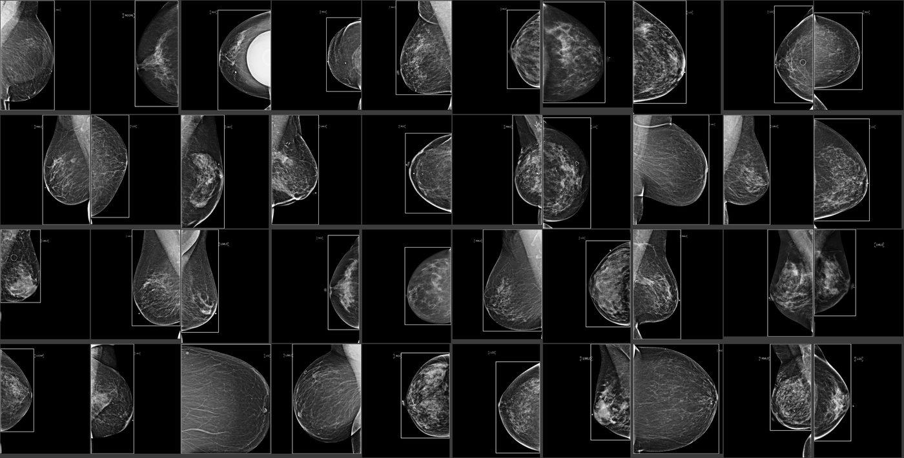</p>
<p align="center"><sub><b>Figure 6.</b> Crop check: the old crop (left) and the fixed crop (right). The old crop occasionally sliced through tissue; the fix is used in all v2 results.</sub></p>

</details>

<details>
<summary><b>Training</b> · Figures 7, 8</summary>
<br>

<p align="center">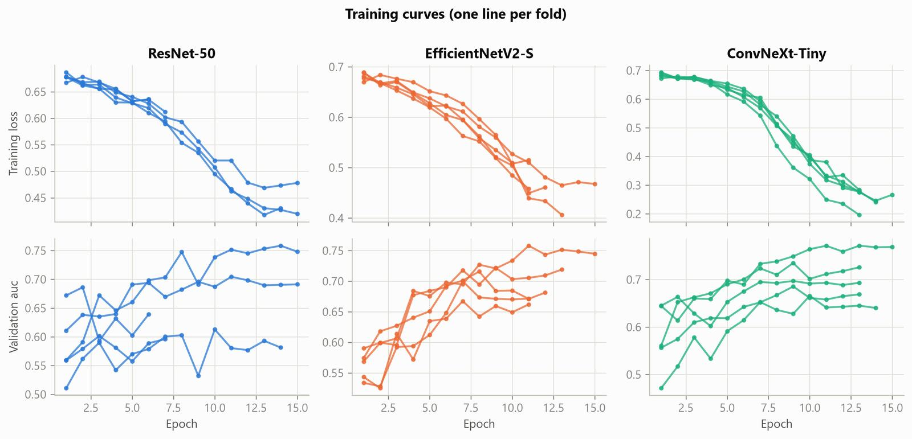</p>
<p align="center"><sub><b>Figure 7.</b> Training curves for Task A: training loss and validation AUC per fold, three backbones.</sub></p>

<p align="center">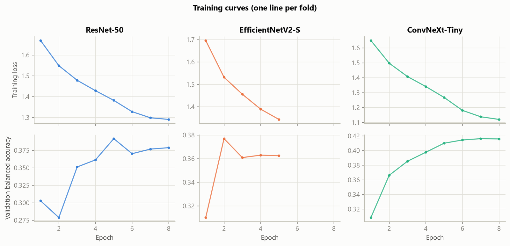</p>
<p align="center"><sub><b>Figure 8.</b> Training curves for Task B (BI-RADS): training loss and validation balanced accuracy, fold 0.</sub></p>

</details>

<details>
<summary><b>Task A: malignant vs. benign</b> · Figures 1, 9, 10, 11, 12, 13, 14, 15, 16</summary>
<br>

<p align="center"></p>
<p align="center"><sub><b>Figure 1.</b> AUC on Task A at each step, on dev and test: 768×512 stack, 1,536×1,024 stack, both combined, then exam type and age, then the radiologist's findings. Lines show the 95% bootstrap CI.</sub></p>

<p align="center">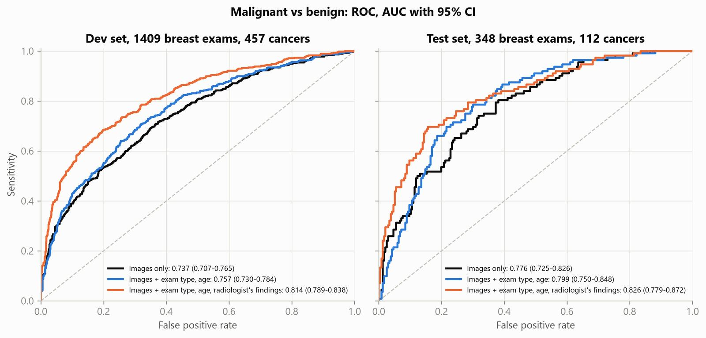</p>
<p align="center"><sub><b>Figure 9.</b> ROC curves on the Task A dev and test sets for the three input combinations.</sub></p>

<p align="center">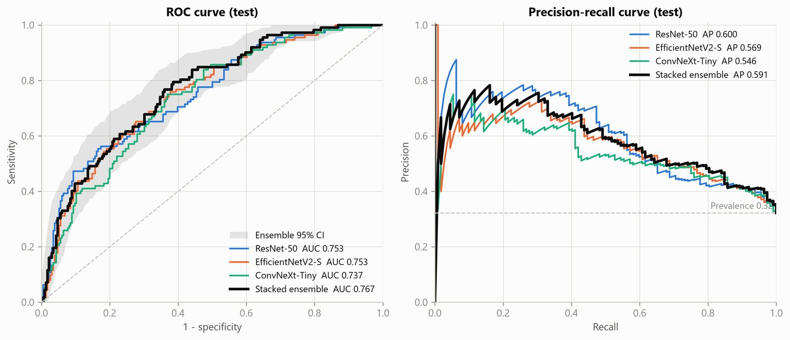</p>
<p align="center"><sub><b>Figure 10.</b> ROC and precision-recall curves on test for the three models of the 1,536×1,024 run and their mean.</sub></p>

<p align="center">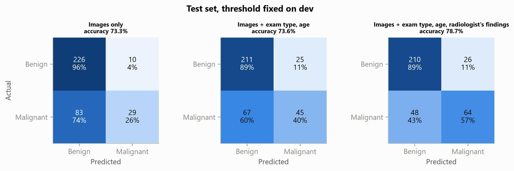</p>
<p align="center"><sub><b>Figure 11.</b> Confusion matrices on test at the max-accuracy threshold, for all three input combinations.</sub></p>

<p align="center">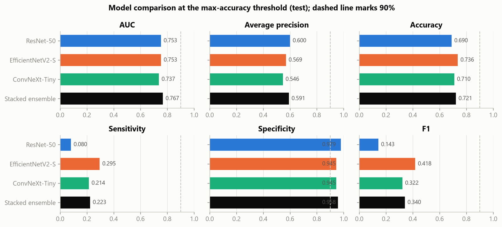</p>
<p align="center"><sub><b>Figure 12.</b> Per-model comparison on test at the max-accuracy threshold (1,536×1,024 run): six metrics per backbone and their mean.</sub></p>

<p align="center"></p>
<p align="center"><sub><b>Figure 13.</b> Calibration on dev and test. Test ECE: images only 0.054, + exam type and age 0.063, + findings 0.044.</sub></p>

<p align="center"></p>
<p align="center"><sub><b>Figure 14.</b> Coverage vs. accuracy: the fewer exams the model decides (most confident first), the more of those decisions are right.</sub></p>

<p align="center">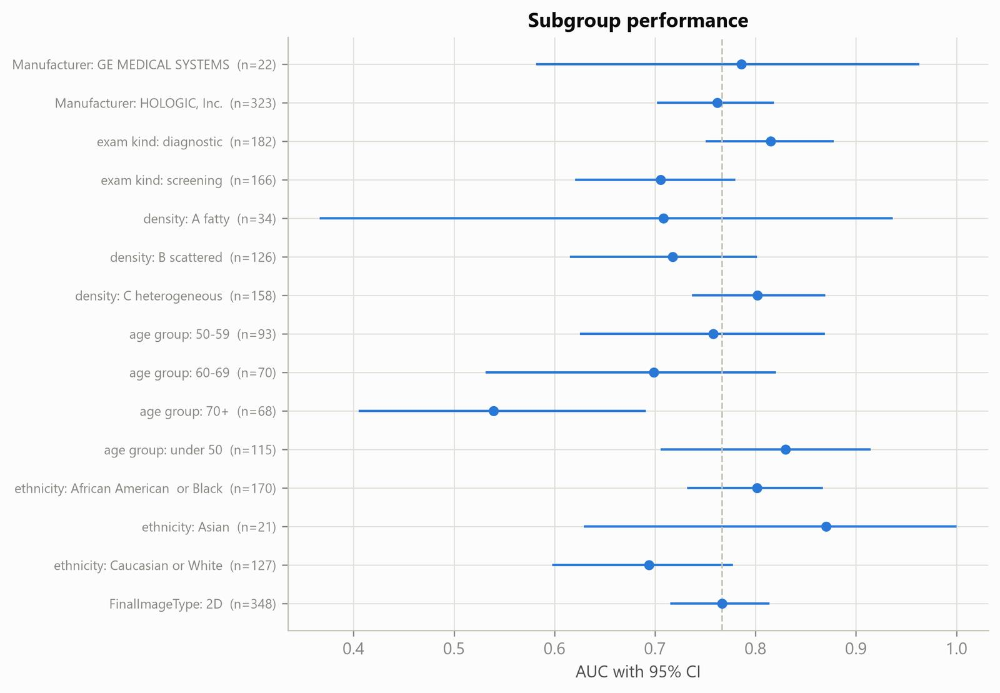</p>
<p align="center"><sub><b>Figure 15.</b> Task A subgroup AUC on test (image-only, 1,536×1,024 run): scanner, exam kind, density, age and ethnicity.</sub></p>

<p align="center"></p>
<p align="center"><sub><b>Figure 16.</b> Grad-CAM maps on Task A test exams (ResNet-50). Attention is mostly on tissue, with some weight on image markers.</sub></p>

</details>

<details>
<summary><b>Task B: BI-RADS</b> · Figures 17, 18, 19, 20</summary>
<br>

<p align="center">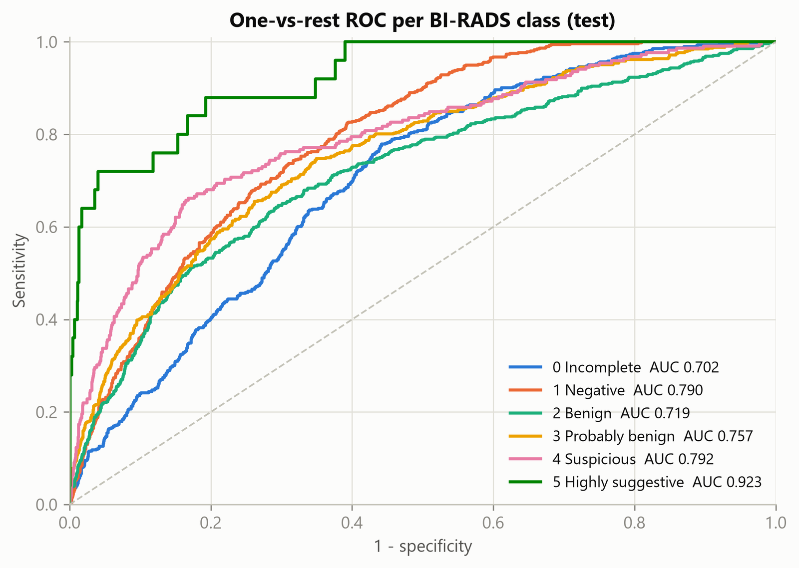</p>
<p align="center"><sub><b>Figure 17.</b> One-vs-rest ROC per BI-RADS class on test.</sub></p>

<p align="center">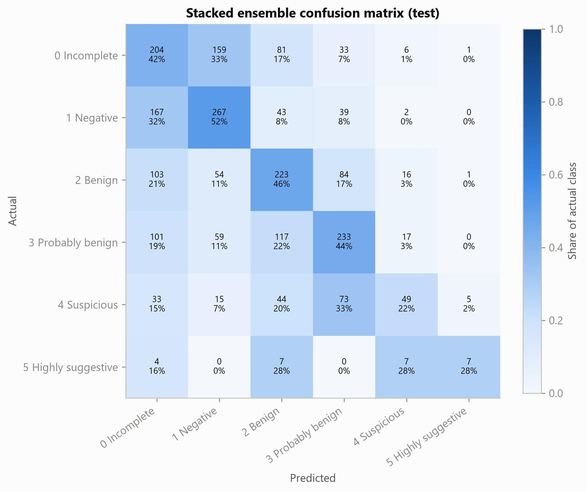</p>
<p align="center"><sub><b>Figure 18.</b> BI-RADS confusion matrix on test.</sub></p>

<p align="center">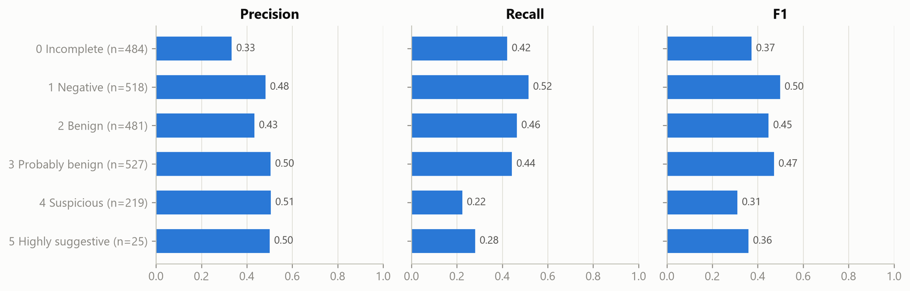</p>
<p align="center"><sub><b>Figure 19.</b> Per-class precision, recall and F1 on test.</sub></p>

<p align="center"></p>
<p align="center"><sub><b>Figure 20.</b> BI-RADS on dev: exam type alone nearly matches the image stack, so the image-only model may be learning the exam-type cue rather than lesion content.</sub></p>

</details>

<details>
<summary><b>Marker-reliance test</b> · Figures 21, 22</summary>
<br>

<p align="center">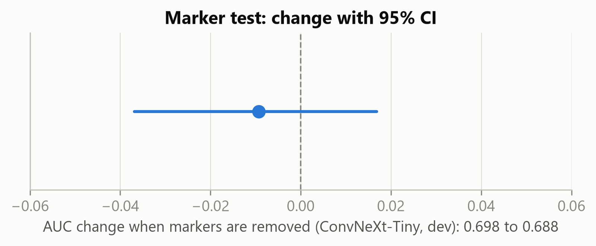</p>
<p align="center"><sub><b>Figure 21.</b> Marker test: AUC with and without markers removed by inpainting (ConvNeXt-Tiny, Task A dev).</sub></p>

<p align="center">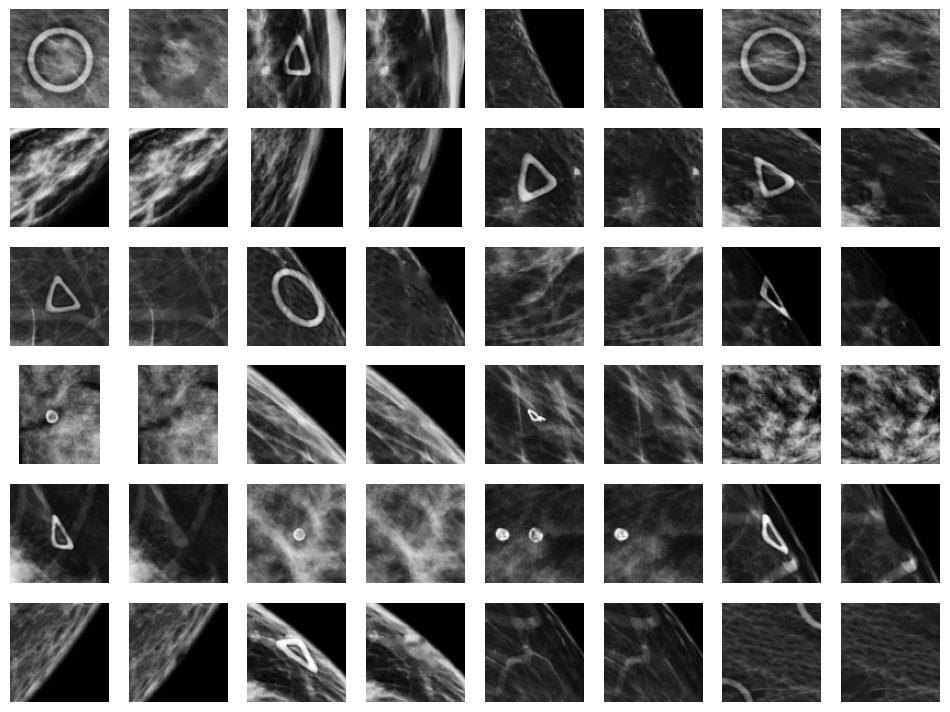</p>
<p align="center"><sub><b>Figure 22.</b> Marker detection and inpainting. The detector catches ~8% of images, erases some rim calcifications and misses some solid dots.</sub></p>

</details>

<details>
<summary><b>Appendix: compute and run logs</b> · Figures A1, A2, A3, A4</summary>
<br>

<p align="center">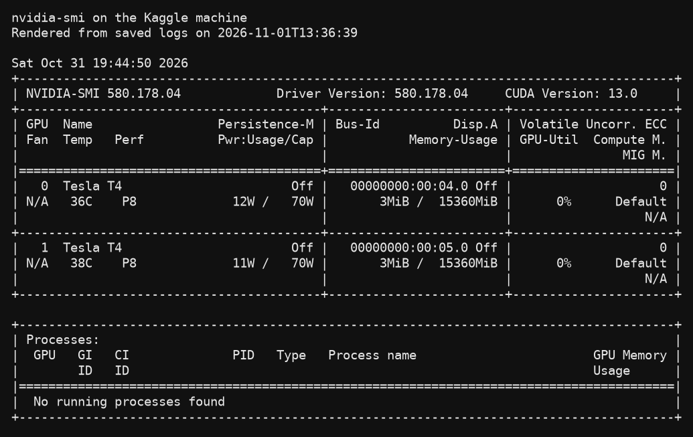</p>
<p align="center"><sub><b>Figure A1.</b> Kaggle GPU allocation (two Tesla T4) at the start of the Task A job.</sub></p>

<p align="center">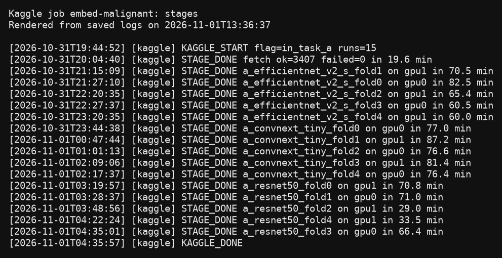</p>
<p align="center"><sub><b>Figure A2.</b> Kaggle job log, Task A (malignant vs. benign): all 15 runs.</sub></p>

<p align="center">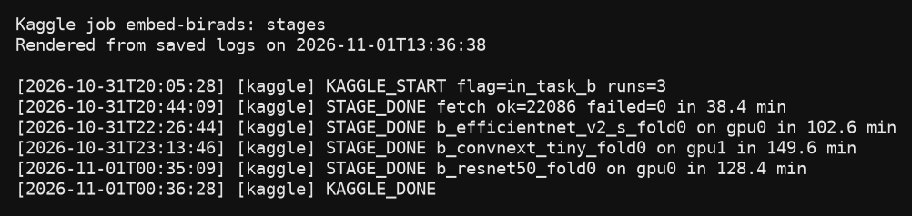</p>
<p align="center"><sub><b>Figure A3.</b> Kaggle job log, Task B (BI-RADS): all 3 runs.</sub></p>

<p align="center">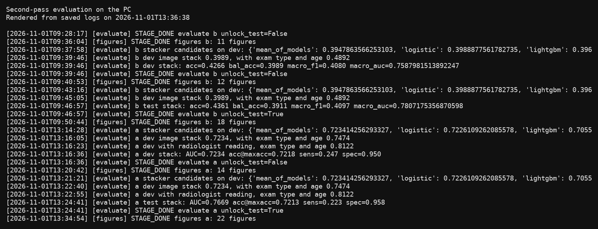</p>
<p align="center"><sub><b>Figure A4.</b> Local evaluation log: stacker candidates with dev and test scores for the second-pass run.</sub></p>

</details>

## Background: NeuroSentry (phase 1)

The team started with **NeuroSentry**, intracranial hemorrhage detection on the CQ500 head-CT dataset (491 scans). The DICOM pipeline, series selection, three-window preprocessing and a DenseNet-121 baseline were validated end to end. The work was then paused, and the team carried the same methods (patient-level splits, locked test sets, bootstrap CIs, Grad-CAM) into this mammography study.

## Repository layout

```
src/        pipeline: s0_weights → s1_build_metadata → s2_fetch_images → s3_train → s4_evaluate → s5/s6 figures → s7_proof
kaggle/     job builder, runner and result import for Kaggle GPU runs
configs/    run settings (resolution, folds, models)
results/    aggregate metrics, figures, report figures, proof files
docs/       fix log: every bug found and how it was fixed
report/     full written report
```

Run order: `python src/run_pipeline.py` (add `--dry-run` for a small smoke test, `--final` to open the locked test set). Set `EMBED_CONFIG=kaggle_v2.json` to use the Kaggle settings. You need your own EMBED access and AWS credentials in a `.env` file one level above the repo (`aws_access_key_id`, `aws_secret_access_key`).

## Data and privacy

Results, charts, the full report and its de-identified mammogram figures are published with written approval from Dr. Hari Trivedi of the Emory HITI Lab, the team behind EMBED, given on 2 November 2026. The repository does not redistribute the dataset itself: no raw images, per-patient tables, predictions or model weights are included. To reproduce the work, request your own access to EMBED from Emory.

## Citation

> Jeong, J. J., et al. *The EMory BrEast imaging Dataset (EMBED): A Racially Diverse, Granular Dataset of 3.4 Million Screening and Diagnostic Mammographic Images.* Radiology: Artificial Intelligence, 2023.
